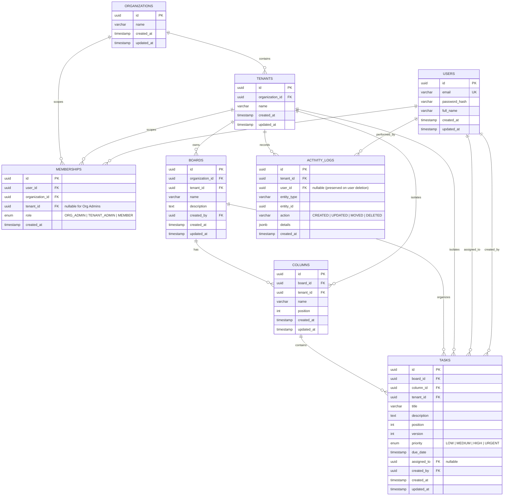

# Database Design & Relational Documentation

This document describes the PostgreSQL relational schema and multi-tenant data architecture implemented using **Prisma ORM** for the Real-Time Collaborative Kanban Board.

---

## 1. Entity-Relationship Diagram (ERD)

---

## 2. Table Specifications

### 2.1 `organizations`
Represents the parent business entity (e.g. *ABC Technologies*).
- `id` (`UUID`, PK): Unique identifier.
- `name` (`VARCHAR(255)`): Corporate organization name.
- `created_at`, `updated_at` (`TIMESTAMP`).

### 2.2 `tenants`
Represents independent branch workspaces within an organization (e.g. *Hyderabad Branch*, *Bangalore Branch*, *Chennai Branch*).
- `id` (`UUID`, PK): Unique branch identifier.
- `organization_id` (`UUID`, FK): Points to parent `organizations.id` (Cascades on delete).
- `name` (`VARCHAR(255)`): Branch name.
- `created_at`, `updated_at` (`TIMESTAMP`).

### 2.3 `users`
Stores registered employee credentials and profile info.
- `id` (`UUID`, PK): Unique user identifier.
- `email` (`VARCHAR(255)`, Unique): Login email.
- `password_hash` (`VARCHAR(255)`): Bcrypt password hash (cost factor 10).
- `full_name` (`VARCHAR(255)`): Display name.
- `created_at`, `updated_at` (`TIMESTAMP`).

### 2.4 `memberships`
Establishes the Role-Based Access Control (RBAC) mapping between users, organizations, and tenants.
- `id` (`UUID`, PK): Unique membership identifier.
- `user_id` (`UUID`, FK): User reference.
- `organization_id` (`UUID`, FK): Organization reference.
- `tenant_id` (`UUID`, FK, Nullable): Nullable for Organization Admins who oversee all branches.
- `role` (`ENUM`):
  - `ORG_ADMIN`: Organization-wide governance, creates tenants and assigns tenant admins.
  - `TENANT_ADMIN`: Branch-level administration, manages boards, columns, and branch members.
  - `MEMBER`: Regular collaborator, creates, edits, and moves task cards within their branch.
- Unique Constraint: `[user_id, organization_id, tenant_id]`.

### 2.5 `boards`
Kanban project workspaces.
- `id` (`UUID`, PK): Board identifier.
- `organization_id` (`UUID`, FK): Parent organization.
- `tenant_id` (`UUID`, FK): **Strict tenant ownership**.
- `name` (`VARCHAR(255)`): Board title.
- `description` (`TEXT`): Project scope details.
- `created_by` (`UUID`, FK): User who created the board.

### 2.6 `columns`
Workflow status lanes (e.g., *To Do*, *In Progress*, *Testing*, *Done*).
- `id` (`UUID`, PK): Column identifier.
- `board_id` (`UUID`, FK): Parent board.
- `tenant_id` (`UUID`, FK): **Direct tenant relationship** ensuring strict data isolation.
- `name` (`VARCHAR(255)`): Status title.
- `position` (`INT`): Display ordering (e.g., 1000, 2000, 3000).

### 2.7 `tasks`
Individual work items on the Kanban board.
- `id` (`UUID`, PK): Task identifier.
- `board_id` (`UUID`, FK): Parent board.
- `column_id` (`UUID`, FK): Current workflow column.
- `tenant_id` (`UUID`, FK): **Direct tenant relationship** preventing cross-tenant card leaks.
- `title` (`VARCHAR(255)`): Task summary.
- `description` (`TEXT`): Detailed task requirements.
- `position` (`INT`): Card ordering within the column (1000, 2000...).
- `version` (`INT`, Default `1`): **Monotonic counter for Optimistic Concurrency Control (OCC)**. Incremented on every update or movement to reject stale concurrent edits with `409 Conflict`.
- `priority` (`ENUM`: `LOW`, `MEDIUM`, `HIGH`, `URGENT`).
- `due_date` (`TIMESTAMP`, Nullable).
- `assigned_to` (`UUID`, FK, Nullable): Assignee user.
- `created_by` (`UUID`, FK): Creator user.

### 2.8 `activity_logs`
Tenant audit trail recording all board and task mutations.
- `id` (`UUID`, PK): Log entry identifier.
- `tenant_id` (`UUID`, FK): Scopes logs strictly to the tenant branch.
- `user_id` (`UUID`, FK, Nullable): Actor ID. **Configured with `onDelete: SetNull` so that historical audit entries remain intact even if an employee account is deleted**.
- `entity_type` (`VARCHAR(50)`): `TASK`, `COLUMN`, or `BOARD`.
- `entity_id` (`UUID`): ID of the affected entity.
- `action` (`VARCHAR(50)`): `CREATED`, `UPDATED`, `MOVED`, or `DELETED`.
- `details` (`JSONB`): Detailed payload (e.g. `{ fromColumn: "To Do", toColumn: "Done" }`).
- `created_at` (`TIMESTAMP`): Mutation timestamp.

---

## 3. Multi-Tenant Isolation Strategy at Schema Level

1. **Foreign Key Scope Binding**:
   - Every tenant-owned model (`boards`, `columns`, `tasks`, `activity_logs`) carries an explicit `tenant_id` foreign key.
   - When joining or querying, the database index `@@index([tenantId])` guarantees fast, scoped lookups without scanning rows belonging to other tenants.
2. **Cascading Safety**:
   - Deleting a tenant automatically cascades to remove its dependent boards, columns, tasks, and activity logs.
   - Removing a user preserves activity log history with `user_id = NULL`.
3. **No Cross-Tenant Entity References**:
   - A task references both `column_id` and `tenant_id`.
   - The application service layer verifies `task.tenant_id === column.tenant_id` on every move operation to guarantee that cards cannot be dragged across branch boundaries.
